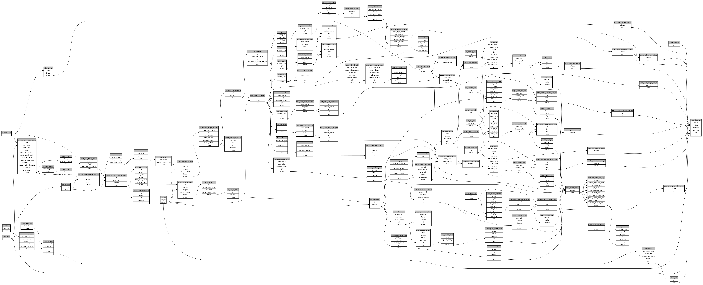

```
# AUTOGENERATED BY ECOSCOPE-WORKFLOWS; see fingerprint in README.md for details

```

```yaml
# fingerprint:
artifacts_sha256_basic: 0f168bba3cc96749caf23cd21a160b33eba684b7c5c1ac8a1c29dcf8476416ef
artifacts_sha256_strict: 15c81a85ad4242efbd13decbfb0f295c7ebc7ce70729d4b751e119d4a33bb11e
installed_requirements:
- channel: https://repo.prefix.dev/ecoscope-workflows/
  name: ecoscope-platform
  version: {version: ==2.25.3}
- channel: https://repo.prefix.dev/ecoscope-workflows-custom/
  name: ecoscope-workflows-ext-custom
  version: {version: ==0.1.4}
- channel: https://repo.prefix.dev/ecoscope-workflows-custom/
  name: ecoscope-workflows-ext-ste
  version: {version: ==0.0.24}
- channel: https://repo.prefix.dev/ecoscope-workflows-custom/
  name: ecoscope-workflows-ext-lion-guardians
  version: {version: ==0.0.8}
- channel: conda-forge
  name: pydeck
  version: {version: ==0.9.2}
- channel: conda-forge
  name: opentelemetry-sdk
  version: {version: ==1.45.1}
params_sha256: 8aa48859aa8446bba225adf52c649731dea9bc91ccb7434f5d87ab8513c46a3c
spec_sha256: a5a38308b96c3af46996f35b011706d221dcf51f7aea4c1a369192f086842f71

```

# ecoscope-workflows-patrols-workflow


