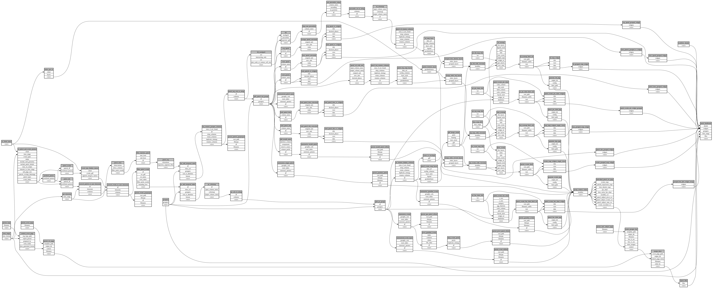

```
# AUTOGENERATED BY ECOSCOPE-WORKFLOWS; see fingerprint in README.md for details

```

```yaml
# fingerprint:
artifacts_sha256_basic: 2bead4a68c9f8d68266aa40bd849f2a12f2d9120163bb8e050e1174015bf2c34
artifacts_sha256_strict: d5690ebb778cbcef9521419cc30f7800b857929d5ac1ea78e77a8d6c8efe4409
installed_requirements:
- channel: https://repo.prefix.dev/ecoscope-workflows/
  name: ecoscope-platform
  version: {version: ==2.28.0}
- channel: https://repo.prefix.dev/ecoscope-workflows-custom/
  name: ecoscope-workflows-ext-custom
  version: {version: ==0.1.4}
- channel: https://repo.prefix.dev/ecoscope-workflows-custom/
  name: ecoscope-workflows-ext-ste
  version: {version: ==0.0.28}
- channel: https://repo.prefix.dev/ecoscope-workflows-custom/
  name: ecoscope-workflows-ext-lion-guardians
  version: {version: ==0.0.9}
- channel: conda-forge
  name: pydeck
  version: {version: ==0.9.2}
- channel: conda-forge
  name: opentelemetry-sdk
  version: {version: ==1.45.2}
params_sha256: 62fbeb4beec15c041eff9669b0dfd3e38e856c114fda868593783946132852c2
spec_sha256: a7496e3b1de3565397e0bf9a60246a0b2f7adeef6c1fa6f52edcc59c5398f8f7

```

# ecoscope-workflows-patrols-workflow


